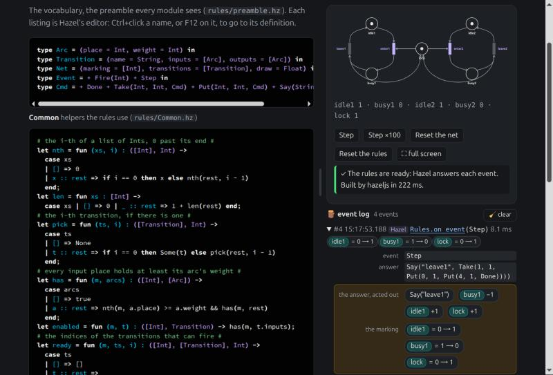
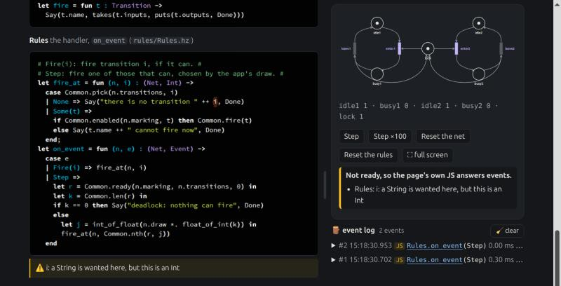
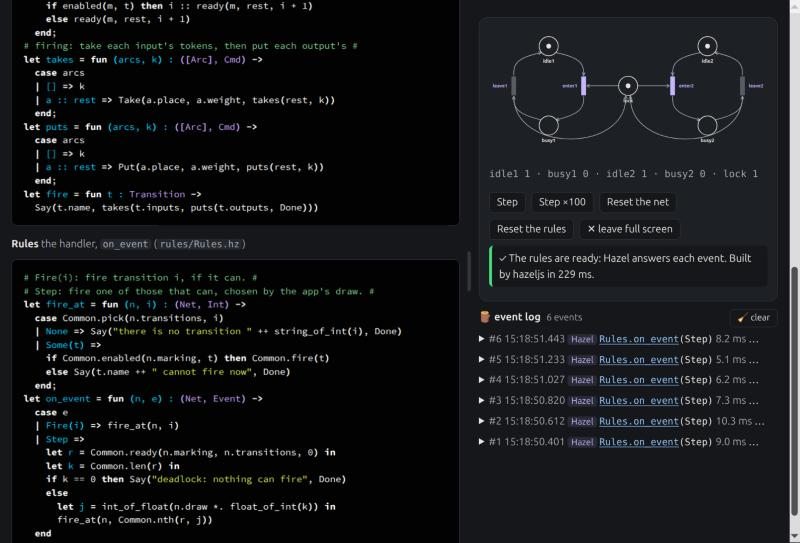

# hazeljs-petri-example

**▶ Try it at https://matthewhammer.org/hazeljs-petri-example/**

**A Petri net simulator whose firing rule is written in [Hazel](https://hazel.org), and run by [hazeljs](https://www.npmjs.com/package/hazeljs).** The page keeps the net and draws it; on each event it hands a typed view of the net to a Hazel function and acts out the command that comes back. Edit the rules in Hazel's own editor while the net runs, and the net itself, which is Hazel too (`Main`): the page draws it again after each edit. While the rules have an error or a hole, the page's own JavaScript answers instead.

It is an example app for `hazeljs`, the second one after [Messed Up Dress Up](https://matthewhammer.org/kids-choice-games/dress-up/), a game whose rooms are scripted the same way. How it works, step by step, with the same example live on the page: [Scripting a JavaScript App in Hazel](https://matthewhammer.org/hazel/reports/043/).

> **Experimental.** `hazeljs` is a 0.0.x prototype, and Hazel's tile editor comes from a branch build of Hazel. The site is the page as it is; its redesign in Messed Up Dress Up's style is planned ([PLAN.md](PLAN.md)).

The rules on the left, each module in Hazel's own editor, and the net on the right, with its buttons and its event log. An opened entry shows the event, Hazel's answer, and the tokens it moved:



An error is shown under the listing it is in, in words. Here `++` joins a string to an Int. While the rules have an error or a hole, the page's own JavaScript answers each event, and the log says which engine answered (`JS`):



**The app opens full screen**, filling the window to its edges, in two columns; **✕ leave full screen** (or Escape) gives the page around it, and **⛶ full screen** goes back. Drag the divider between the columns to give the rules or the net more room, on the page as well as in full screen. You can also use the arrow keys on the divider, and a double-click puts it back:



## Run it

The page needs to be served over http, from `localhost` (Hazel's editor frames take messages only from a few sites, `localhost` among them):

```sh
git clone https://github.com/matthewhammer/hazeljs-petri-example
cd hazeljs-petri-example
python3 -m http.server 8000 --bind 127.0.0.1
```

Then open http://localhost:8000/. The page loads `hazeljs` from npm through jsDelivr, so nothing needs installing for it.

The same rules in Node, with what each step costs:

```sh
npm install
npm run example
```

## What is where

| File | What it is |
|---|---|
| `rules/preamble.hz` | The vocabulary, in Hazel: what a rule is told (`Net`), what can happen (`Event`), and what it may answer (`Cmd`, a chain of commands ending in `Done`). |
| `rules/Common.hz` | Helpers: which transitions can fire, and firing one as commands. |
| `rules/Rules.hz` | The handler, `on_event : (Net, Event) -> Cmd`: `Fire(i)` fires transition `i` if it can; `Step` fires one of those that can, chosen by a random draw the page passes in. |
| `rules/Main.hz` | The net, in Hazel: its places, its transitions with their input and output arcs, the starting marking, and where each place and transition is drawn; and the handler the page calls (`Main.on_event`, the rule). Two processes sharing one lock. Edit it on the page and the page draws the net again. |
| `index.html`, `js/app.js` | The page, and its loader: it reads the files above into the page. |
| `js/live.js` | The net and its events, the page's own JS handler, `hazeljs` building the rules, and the 🪵 event log. Shared with the report. |
| `js/hazel-listings.js` | Turns each `<pre class="hazel">` into Hazel's editor, and makes go to definition work between them. Shared with the report. |
| `node/petri.mjs` | The Node example: events by hand, 2,000 random steps, a mistake and a hole, and their costs. |

## Your own kind of Petri net

Most of what makes one group's nets differ from another's goes in three places: the vocabulary (`rules/preamble.hz`), the helpers (`rules/Common.hz`), and the net (`rules/Main.hz`). For example:

- **Coloured nets**, whose tokens carry data (some groups call the colours *types*): a place's tokens become a list of Hazel values of that place's type, and a transition's guard and output become Hazel functions. Hazel's type checker then checks the colours as you write them.
- **Weights, inhibitor arcs, priorities, timing:** a field in the net (`rules/Main.hz`), a case in `Common`, a word in the vocabulary.
- **Which enabled transition fires** is the rule's choice (`Step`), so a scheduling policy is a few lines of Hazel, swapped without touching the app.

[PLAN.md](PLAN.md) has what comes next, including more nets.

## Things to know

- **Build a value in the order of its Hazel type's fields.** `hazeljs` 0.0.4 converts a JS object into a labeled tuple by the object's key order, and when a field is a list, an object in another order gets stuck at the type annotation (the call returns `{hazel: "..."}`). So the page passes `{marking, transitions, draw}`, in `Net`'s order. A bug, to be fixed in `hazeljs`.
- **Hazel answers in a few milliseconds** a call (about 3.5 ms in Node on a laptop, against under a microsecond for the same handler in JS), fine for each click, not yet for a simulator's inner loop.
- **Undo in the editors** is the page's job today, as is the editor itself (from a branch build of Hazel); both are planned for `hazeljs`.

## Licences

Copyright 2026 Matthew Hammer. The code (the `.js`, `.mjs`, `.html`, `.css`, `.json` and `.hz` files) is under the [Apache License 2.0](LICENSE); everything else (the `.md` files) under [Creative Commons Attribution 4.0](LICENSE-CC-BY-4.0). See [NOTICE](NOTICE).
